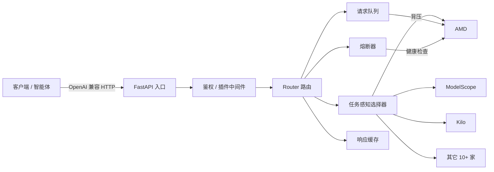

# Free-Router

**独立的免费/收费大模型聚合路由网关**（OpenAI 兼容）。把多家免费提供商的模型聚合成一个端点，
按 **质量分级 + 任务需求 + 额度** 自动选型、自动跨提供商顺延、额度恢复自动回切；
全部免费模型不可用时用本地缓存兜底，保证任务不中断。

- **不依赖任何 agent 框架**：任何能发 HTTP 的智能体（Hermes / QwenPaw / OpenCode / Cursor / 自研脚本）把 `base_url` 指向它即可。
- **密钥一律留空**：仓库里不写任何 key，全部从 `.env` / 环境变量读取。

## 快速开始

```bash
pip install .
free-router                       # 默认 127.0.0.1:8787

# 或直接跑
pip install -r requirements.txt
python -m uvicorn app.main:app --host 127.0.0.1 --port 8787

# 或 Docker
docker compose up -d
```

验证：

```bash
curl -s http://127.0.0.1:8787/health
curl -s -X POST http://127.0.0.1:8787/v1/chat/completions \
     -H "Content-Type: application/json" \
     -d '{"messages":[{"role":"user","content":"reply OK only"}]}'
```

## 架构



## 核心能力

| 能力 | 说明 |
|---|---|
| 自动选型 | 质量分级 + 任务上下文 + 能力标签打分排序 |
| 容错切换 | 单模型 429/5xx 冷却，跨提供商自动顺延（最多 20 次） |
| 额度预测 | 按速率预估剩余额度，提前避开即将耗尽模型 |
| 缓存兜底 | 全部不可用时用最近成功响应兜底 |
| 多租户 | `tenant` 维度隔离用量与冷却 |
| 多 Key | 每提供商多账号轮换（failover / round_robin） |

## 文档导航

- [配置](configuration.md) · [API 参考](api-reference.md) · [提供商](providers.md)
- [可观测性](observability.md) · [插件](plugins.md) · [部署](deployment.md) · [FAQ](faq.md)
